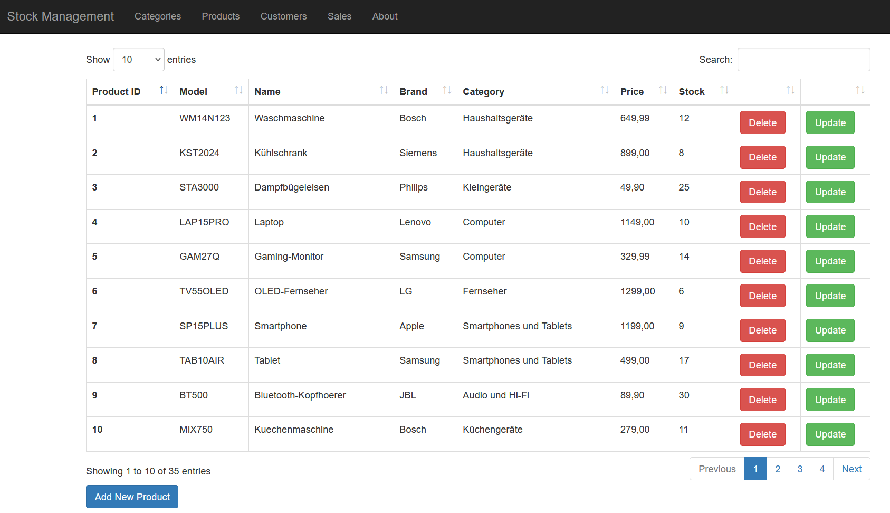
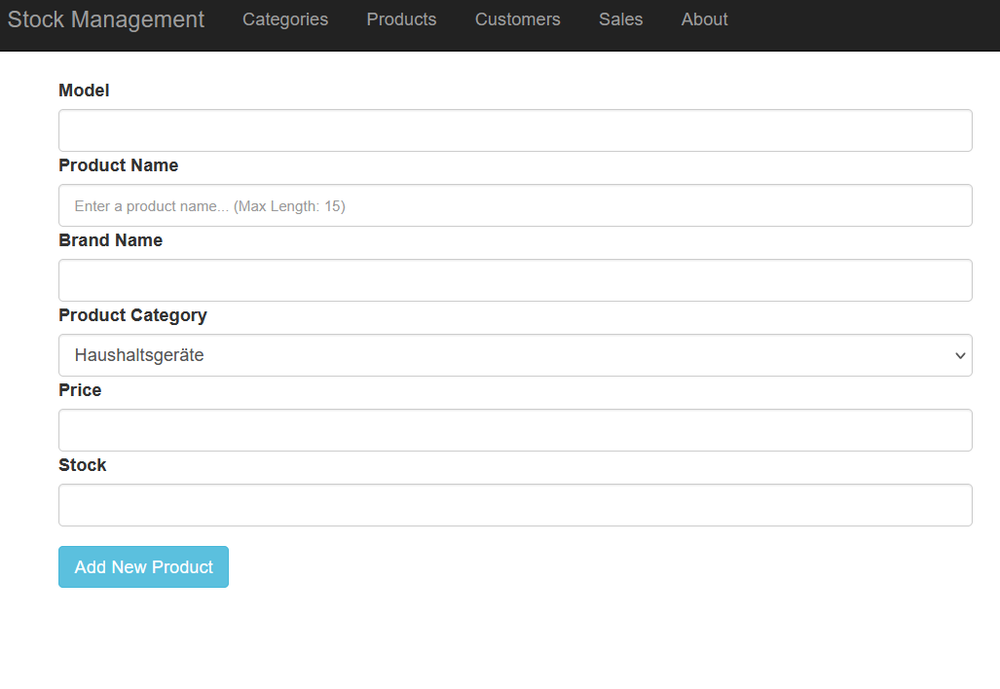
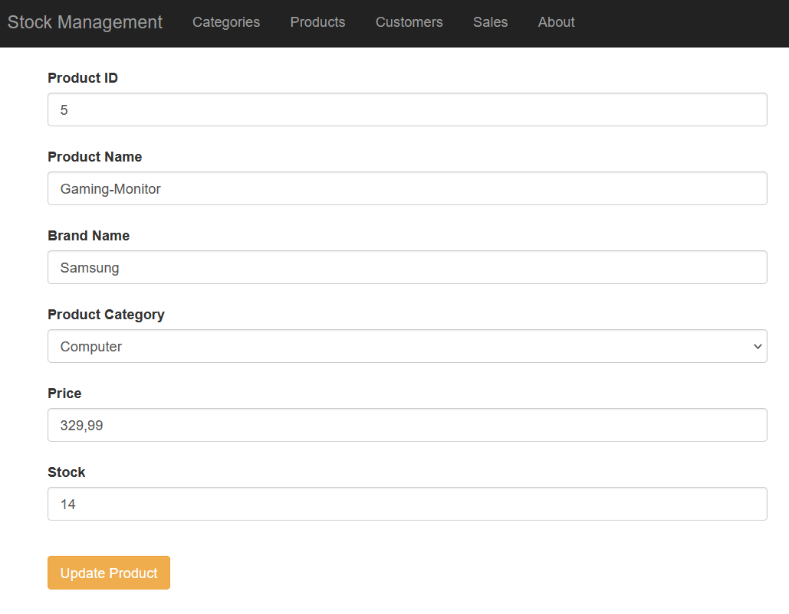
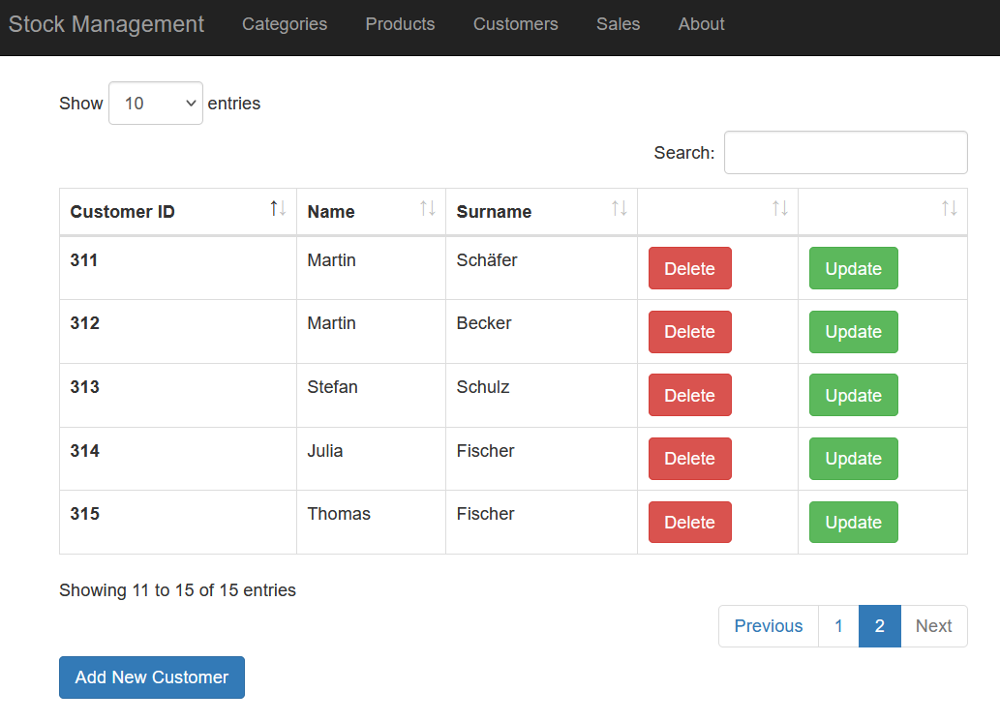
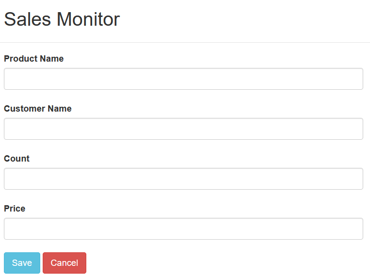

# MvcStock – Inventory Management System

An inventory management web application developed using C# and ASP.NET MVC 5.

## Technologies

- C#.NET
- ASP.NET MVC 5
- Entity Framework (Database First)
- Microsoft SQL Server
- HTML5
- CSS3
- Bootstrap 3
- JavaScript
- jQuery

## Features

- Category management (CRUD)
- Product management (CRUD)
- Customer management (CRUD)
- Sales management
- Database integration using Entity Framework
- Responsive user interface

## Project Structure

The application follows the ASP.NET MVC architecture, separating Models, Views and Controllers.

## Purpose

This project was developed as a practical exercise to strengthen my C#.NET development skills and demonstrate my knowledge of ASP.NET MVC and database-driven web applications.

## Screenshots

### Products

### Products

### Products

### Customers

### Sales

